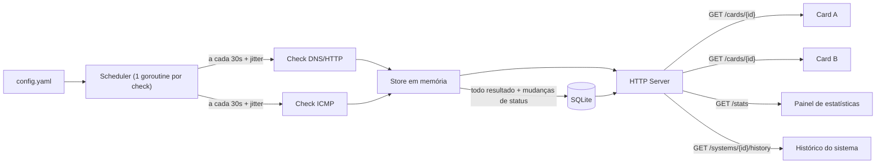

# Sentinela — Plano de Criação

Monitor simples de disponibilidade: para cada sistema, verifica **DNS/URL** (resolução + HTTP) e **IP da máquina** (ICMP ping) e exibe em cards independentes que mudam de cor conforme o status. Mantém um **histórico de logs por sistema** com diagnóstico da causa (DNS, aplicação/proxy ou VM).

---

## 1. Decisões de Stack

| Camada | Escolha | Motivo |
|---|---|---|
| Backend | **Go 1.23+** (stdlib `net/http`, `html/template`) | Binário único, concorrência nativa, sem framework |
| Ping ICMP | `github.com/prometheus-community/pro-bing` em **modo privilegiado** | Permissão `cap_net_raw` considerada disponível (revisar se der problema) |
| Config | YAML (`gopkg.in/yaml.v3`) | Lista de sistemas editável sem recompilar |
| Frontend | **HTML + HTMX + CSS puro** (design tokens em CSS variables) + JS puro mínimo, embutido no binário via `go:embed` | Cada card faz sua própria requisição (`hx-get` + `hx-trigger="every Ns"`) sem build JS, sem SPA. Detalhes visuais na seção 9 |
| Estado atual | **Memória** (`sync.RWMutex`) | Leitura rápida para os cards |
| Histórico | **SQLite** via `modernc.org/sqlite` (Go puro, sem CGO) | Arquivo único, sem servidor de banco, suficiente para o volume |
| Deploy | Dockerfile multi-stage + `--cap-add=NET_RAW` (ou `setcap cap_net_raw+ep`) | ICMP exige raw socket |

---

## 2. Arquitetura



**Ponto-chave:** os checks rodam **no backend**, em intervalo fixo, independente de quantas pessoas estão com a tela aberta. O navegador só **lê o último resultado em cache**. Assim:
- 50 abas abertas ≠ 50× pings nos sistemas (sem risco de rate limit causado pelo front).
- Cada card é uma requisição isolada; se um falhar/demorar, os outros não são afetados.

---

## 3. Intervalos e Regras de Status

| Parâmetro | Valor padrão | Justificativa |
|---|---|---|
| Intervalo de check (backend) | **30s** | ~2 req/min por sistema: longe de qualquer rate limit, detecção rápida |
| Jitter inicial | 0–10s aleatório por check | Evita que todos os sistemas sejam pingados no mesmo instante |
| Timeout por check | **5s** (HTTP) / **3s** (ICMP, 3 pacotes) | Não trava o ciclo |
| Falhas consecutivas p/ DOWN | **2** | Evita falso positivo por um pacote perdido |
| Latência p/ DEGRADED | HTTP > 2000ms / ICMP perda > 0% e < 100% | Sinaliza lentidão antes de cair |
| Polling do card (front) | **15s** | Metade do intervalo de check → atraso máximo na tela ≈ 15s |

**Tempo máximo até mostrar queda:** ~30s (1ª falha) + 30s (2ª falha) + 15s (polling) ≈ **75s**. Todos os valores são configuráveis no `config.yaml` (global e por sistema). Intervalo mínimo aceito: 10s.

### Estados e cores

| Estado | Rótulo / cor (ver 9.2) | Regra |
|---|---|---|
| `UP` | Operacional · verde `#2FBF71` | Último check OK |
| `DEGRADED` | Instável · âmbar `#E0A526` | OK porém lento, perda parcial de pacotes ou 1 falha isolada |
| `DOWN` | Fora do ar · vermelho `#F0524F` | ≥ 2 falhas consecutivas |
| `UNKNOWN` | Sem dados · cinza `#6B7380` | Ainda não checado / não configurado |

O **card** tem dois indicadores (DNS e IP). A borda/fundo do card assume o **pior** dos dois estados.

---

## 4. Checks

### 4.1 DNS/HTTP — modo híbrido

Cada etapa é medida separadamente para que o erro seja **classificado** (base do diagnóstico no histórico):

1. **Resolução DNS** — `net.Resolver.LookupHost` com timeout. Falha → categoria `dns`.
2. **Requisição HTTP** — `GET` com `context.WithTimeout`, um único `http.Client` reutilizado. Falha de conexão/TLS/timeout → categorias `connect`, `tls`, `timeout`.
3. **Avaliação da resposta:**

| Sistema tem `health_path`? | Considera **OK** | Considera **FALHA** |
|---|---|---|
| **Sim** (ex.: `/health`) | `2xx` (ou `expected_status` se configurado) | qualquer outro status |
| **Não** (usa a URL base) | qualquer status **< 500** (inclusive 401/403/404: o servidor está respondendo) | `5xx` |

**Detecção de Cloudflare / proxy:** se a resposta tiver header `Server: cloudflare` ou `CF-RAY`, ou status `520–526`, a falha é marcada como `proxy` com o detalhe (ex.: *"Cloudflare 502 — origem não respondeu"*). Isso separa "a borda está de pé mas a aplicação/VM atrás não" de "o domínio nem resolve".

Categorias de erro gravadas: `dns`, `connect`, `tls`, `timeout`, `http_5xx`, `proxy`, `unexpected_status`.

### 4.2 IP — ICMP

- 3 pacotes via `pro-bing` (`SetPrivileged(true)`); OK se recebeu ≥ 1. Guarda RTT médio e % de perda.
- **Fallback opcional:** `tcp_port` no config faz TCP connect no IP (ex.: 22 ou 443), para hosts com ICMP bloqueado.
- Categorias de erro: `icmp_timeout`, `icmp_loss`, `tcp_refused`, `permission` (falta de `cap_net_raw` — fica visível no card para facilitar a revisão).

---

## 5. Histórico de Logs e Diagnóstico

Objetivo: responder *"às 14h o sistema caiu — foi DNS, aplicação ou a VM desligou?"*.

### 5.1 O que é gravado

- **`checks`** — todo resultado de cada check (DNS e IP), com categoria de erro. Permite reconstruir a linha do tempo exata.
- **`events`** — só as **mudanças de status** (UP→DOWN, DOWN→UP…), já com o **diagnóstico** calculado no momento. É a visão de leitura rápida.

### 5.2 Regra de diagnóstico (cruza DNS × IP no momento do evento)

| DNS/HTTP | IP | Diagnóstico exibido |
|---|---|---|
| falha `dns` | UP | **Problema de DNS** — nome não resolve, máquina no ar |
| falha `proxy` / `http_5xx` | UP | **Aplicação fora** — VM no ar, serviço/proxy retornando erro (ex.: Cloudflare 502) |
| falha `connect` / `timeout` | UP | **Serviço não responde** — VM no ar, porta/app parado |
| falha (qualquer) | DOWN | **VM/rede fora** — máquina não responde ao ping |
| UP | DOWN | **Ping falhando** — app responde; IP pode estar errado ou ICMP bloqueado |
| `tls` | qualquer | **Certificado TLS inválido/expirado** |

### 5.3 Schema SQLite

```sql
CREATE TABLE checks (
  id          INTEGER PRIMARY KEY,
  system_id   TEXT    NOT NULL,
  kind        TEXT    NOT NULL,          -- 'dns' | 'ip'
  ok          INTEGER NOT NULL,
  status_code INTEGER,                   -- HTTP, se houver
  latency_ms  INTEGER,
  loss_pct    REAL,                      -- ICMP
  error_cat   TEXT,                      -- dns, proxy, icmp_timeout...
  error_msg   TEXT,
  checked_at  DATETIME NOT NULL
);
CREATE INDEX idx_checks_sys_time ON checks(system_id, checked_at);

CREATE TABLE events (
  id          INTEGER PRIMARY KEY,
  system_id   TEXT    NOT NULL,
  kind        TEXT    NOT NULL,          -- 'dns' | 'ip'
  from_status TEXT    NOT NULL,
  to_status   TEXT    NOT NULL,
  diagnosis   TEXT,
  detail      TEXT,
  occurred_at DATETIME NOT NULL
);
CREATE INDEX idx_events_sys_time ON events(system_id, occurred_at);
```

### 5.4 Volume e retenção

- 2 checks / 30s por sistema ≈ 5.760 linhas/dia/sistema. Com 30 sistemas ≈ 170 mil/dia — tranquilo para SQLite com índice.
- Retenção configurável: **`checks` 7 dias**, **`events` 90 dias**. Job de limpeza 1×/hora (goroutine com ticker + `ctx`).
- SQLite em modo **WAL** (`PRAGMA journal_mode=WAL`) e **um único escritor** (canal com goroutine que grava em lote a cada 1s), evitando `database is locked`.
- Falha ao gravar no banco **não** derruba o monitoramento: loga o erro e segue (estado em memória continua correto).

---

## 6. Configuração (`config.yaml`)

```yaml
server:
  addr: ":8080"
storage:
  path: ./data/sentinela.db
  retention_checks: 168h   # 7 dias
  retention_events: 2160h  # 90 dias
defaults:
  interval: 30s
  http_timeout: 5s
  ping_timeout: 3s
  fail_threshold: 2
  degraded_latency: 2s
systems:
  - id: erp
    name: ERP
    url: https://erp.empresa.com.br
    health_path: /health        # tem health → exige 2xx
    ip: 10.0.0.15
  - id: portal
    name: Portal do Cliente
    url: https://portal.empresa.com.br   # sem health → OK se status < 500
    ip: 10.0.0.22
  - id: legado
    name: Sistema Legado
    ip: 10.0.1.5
    tcp_port: 22                # ICMP bloqueado → usa TCP
```

Validação no startup: `id` único e obrigatório (slug), ao menos `url` ou `ip`, URL parseável, `health_path` começando com `/`, IP válido, intervalo ≥ 10s. Erro de config → processo não sobe.

---

## 7. Estrutura do Projeto

```
sentinela/
├── cmd/sentinela/main.go        # carrega config, abre DB, inicia scheduler e servidor, graceful shutdown
├── internal/
│   ├── config/config.go         # struct + Load + Validate
│   ├── checker/
│   │   ├── http.go              # CheckHTTP: DNS + HTTP híbrido + detecção Cloudflare
│   │   └── ping.go              # CheckICMP / CheckTCP
│   ├── monitor/
│   │   ├── store.go             # estado em memória, regras de status, ring buffer (uptime 1h)
│   │   ├── diagnosis.go         # regra DNS × IP → diagnóstico
│   │   └── scheduler.go         # 1 goroutine por check com ticker, encerra via ctx
│   ├── storage/
│   │   ├── sqlite.go            # Open, migrations, writer em lote, retenção
│   │   └── queries.go           # ListEvents, ListChecks, Uptime24h
│   └── web/
│       ├── server.go            # rotas e handlers
│       ├── templates/           # layout, index, card, stats, history, partials/ (heartbeat, sparkline)
│       └── static/              # css/tokens.css, css/app.css, js/app.js, vendor/htmx.min.js, fonts/, icons.svg
├── config.example.yaml
├── Dockerfile
├── Makefile                     # run, build, test, lint
└── go.mod
```

### Modelo de dados (em memória)

```go
type Result struct {
    OK         bool
    StatusCode int
    Latency    time.Duration
    Loss       float64       // só ICMP
    ErrorCat   string        // dns, proxy, icmp_timeout...
    Error      string
    CheckedAt  time.Time
}

type CheckState struct {
    Status      Status        // UP | DEGRADED | DOWN | UNKNOWN
    Last        Result
    ConsecFails int
    LastChange  time.Time     // desde quando está nesse status
    History     [120]Result   // ring buffer ≈ 1h com intervalo de 30s
}

type SystemState struct {
    ID, Name string
    DNS, IP  *CheckState      // nil se não configurado
}
```

---

## 8. Endpoints

| Método | Rota | Retorno | Uso |
|---|---|---|---|
| GET | `/` | HTML: layout + cards "esqueleto" | Carrega a página uma única vez |
| GET | `/cards/{id}` | HTML parcial de **um** card | HTMX de cada card, a cada 15s |
| GET | `/stats` | HTML parcial do painel de estatísticas | HTMX do painel, a cada 15s |
| GET | `/systems/{id}/history?from=&to=&kind=` | Página de histórico (eventos + checks com falha) | Investigação de incidentes |
| GET | `/api/systems/{id}` | JSON do estado atual | Integrações / debug |
| GET | `/api/systems/{id}/events?from=&to=` | JSON dos eventos | Integrações / export |
| GET | `/healthz` | `200 ok` (inclui ping no DB) | Health da própria sentinela |

Card no HTML (cada um se atualiza sozinho, troca apenas o próprio conteúdo):

```html
<a class="card card--skeleton" href="/systems/erp/history" style="--i:0"
   hx-get="/cards/erp" hx-trigger="load, every 15s" hx-swap="outerHTML settle:200ms"></a>
```

Se a requisição de um card falhar, o HTMX mantém o último conteúdo e o card mostra "sem atualização desde HH:MM:SS" (evento `htmx:responseError`).

---

## 9. UI/UX — Design System

### 9.1 Direção visual

Referência: **console de operações / NOC**, no estilo de ferramentas de infraestrutura (Grafana, Linear, Vercel dashboard, Better Stack). Visual sóbrio, denso e legível a 3 metros de distância numa TV.

**Princípios**
1. **O status é a única cor forte da tela.** Todo o resto é grafite neutro. Se algo chama atenção, é porque precisa.
2. **Dados em fonte mono, interface em sans.** IPs, latências e horários sempre em `IBM Plex Mono` com `tabular-nums` (os números não "dançam" ao atualizar).
3. **Movimento comunica mudança, não decora.** Só anima quando o estado muda ou para indicar que a tela está viva.
4. **Nunca só cor.** Todo status tem cor + ícone com forma diferente + texto.

**Checklist "sem cara de IA" (proibido)**

| Evitar | Usar no lugar |
|---|---|
| Gradientes roxo/índigo, fundos "aurora" | Fundo grafite sólido, superfícies separadas por borda de 1px |
| Glassmorphism, `backdrop-filter: blur`, glow neon | Bordas finas e contraste de superfície |
| Emojis como ícones, ✨ e afins | Set único de ícones SVG inline com traço de 1.5px |
| Raio gigante (20–32px) e sombras difusas enormes | Raio de 6–8px, sombra só em overlays |
| Inter + títulos enormes "hero" | IBM Plex Sans/Mono, hierarquia por peso e cor, não por tamanho |
| Textos genéricos ("Monitore com facilidade 🚀") | Microcopy técnica e direta ("Fora do ar há 4 min · Cloudflare 502") |
| Tudo centralizado e com muito espaço vazio | Grid denso, alinhado à esquerda, informação acima da dobra |

### 9.2 Paleta de cores (design tokens)

Tema **escuro por padrão** (TV / sala de operações) e tema **claro** opcional (toggle no header, salvo em `localStorage`; o padrão inicial segue `prefers-color-scheme`).

**Neutros**

| Token | Escuro | Claro | Uso |
|---|---|---|---|
| `--bg` | `#0E1013` | `#F6F7F9` | Fundo da página |
| `--surface` | `#15181D` | `#FFFFFF` | Cards, painéis |
| `--surface-2` | `#1C2026` | `#F0F2F5` | Hover, linhas zebradas, inputs |
| `--border` | `#262B33` | `#E1E4E8` | Bordas padrão |
| `--border-strong` | `#363C46` | `#C9CED6` | Hover/foco de card |
| `--text` | `#E6E8EB` | `#14171C` | Texto principal |
| `--text-muted` | `#9198A1` | `#5B636E` | Rótulos, metadados |
| `--text-subtle` | `#5F6772` | `#8A929C` | Placeholders, divisores de texto |
| `--accent` | `#5B9BD5` | `#2F6FB0` | Links, foco, filtro ativo (azul aço, não roxo) |

**Status** (cor sólida + fundo tingido para destaque do card)

| Status | Rótulo na UI | Ícone | Sólido (escuro / claro) | Tint (escuro / claro) |
|---|---|---|---|---|
| `UP` | Operacional | círculo com check | `#2FBF71` / `#1A8F50` | `#122319` / `#E7F6EE` |
| `DEGRADED` | Instável | triângulo | `#E0A526` / `#A86F00` | `#2A2212` / `#FCF3DE` |
| `DOWN` | Fora do ar | octógono com X | `#F0524F` / `#C8302D` | `#2C1517` / `#FDE9E8` |
| `UNKNOWN` | Sem dados | traço | `#6B7380` / `#8A929C` | `#1A1D22` / `#F0F2F5` |

Todas as combinações de texto sólido sobre `--surface` atendem **WCAG AA (≥ 4.5:1)**, a validar na fase de UI com ferramenta de contraste.

**Diagnóstico** (badges do histórico; usam neutros + ícone, só "VM/rede fora" usa vermelho):

| Diagnóstico | Ícone | Estilo |
|---|---|---|
| Problema de DNS | globo | borda `--accent` |
| Aplicação fora / Serviço não responde | caixa/servidor | borda âmbar (`DEGRADED`) |
| VM/rede fora | plug desconectado | fundo tint `DOWN` |
| TLS inválido | cadeado aberto | borda âmbar |
| Ping falhando | sinal com barra | borda `--text-subtle` |

### 9.3 Tipografia

- **UI:** `IBM Plex Sans` (400, 500, 600) · **Dados:** `IBM Plex Mono` (400, 500). Fontes servidas localmente (`woff2` embutido), sem CDN.
- `font-variant-numeric: tabular-nums` em todo número.

| Token | Tamanho / altura de linha | Uso |
|---|---|---|
| `--fs-xs` | 12 / 16 | Metadados, timestamps |
| `--fs-sm` | 13 / 18 | Linhas DNS/IP, tabelas |
| `--fs-md` | 14 / 20 | Texto base |
| `--fs-lg` | 16 / 22 | Nome do sistema no card |
| `--fs-xl` | 20 / 28 | Títulos de página |
| `--fs-2xl` | 28 / 32 | Números do painel de stats |

No modo TV, a escala inteira é multiplicada por `1.25` via `--scale`.

### 9.4 Espaçamento, forma e elevação

- Grid de **4px**: `--sp-1: 4px` … `--sp-8: 32px`.
- Raio: `--radius-sm: 4px` (badges), `--radius: 8px` (cards, painéis), `--radius-full` (dots e pills).
- Elevação: cards **sem sombra**, só borda. Sombra (`0 8px 24px rgb(0 0 0 / .35)`) apenas em tooltip e menus.
- Ícones: SVG sprite próprio (`icons.svg`, ~12 ícones, traço 1.5px, 16/20px), referenciado via `<use href="#icon-x">`.

### 9.5 Componentes

**Header (fixo)**
- Esquerda: logotipo (marca simples: um "radar" em SVG monocromático) + "Sentinela".
- Centro: **busca** (`/` foca o campo) + **chips de filtro**: `Todos · Fora do ar · Instável · Operacional`, cada um com a contagem.
- Direita: indicador "Ao vivo" (dot verde que pulsa devagar; vira cinza "Desconectado" se as requisições falharem), toggle de tema, botão de modo TV.

**Barra de estatísticas (`/stats`)**
- 4 blocos: `Operacional`, `Instável`, `Fora do ar`, `Total`. Número grande em mono com o rótulo pequeno embaixo.
- À direita: "Último ciclo 09:58:12" e "Uptime da sentinela 3d 4h".
- `aria-live="polite"` só aqui, para leitores de tela anunciarem mudanças agregadas sem poluir.

**Card do sistema** (é um `<a>` para o histórico, navegável por teclado)

```
┌──────────────────────────────────────┐
▌ Portal do Cliente      ⬣ Fora do ar  │  ← barra lateral 3px na cor do status + pill
│                                      │
│ DNS  portal.empresa.com.br           │
│      ⬣ Cloudflare 502       —        │  ← dot + erro curto · latência à direita
│ IP   10.0.0.22                       │
│      ● 3 ms                 0% perda │
│                                      │
│ ▮▮▮▮▮▮▮▮▮▮▮▮▮▮▮▮▮▮▮▮▮▮▮▮▮▮▯▯▯▯ 1h   │  ← heartbeat: últimos 30 checks
│                                      │
│ Aplicação fora · há 4 min            │  ← diagnóstico (só quando não está UP)
│ Verificado 09:58:05      Uptime 93%  │
└──────────────────────────────────────┘
```

- **Heartbeat bar:** 30 barrinhas (últimos 30 checks do pior dos dois), renderizadas no servidor como `<span>`s. Hover em cada barra mostra tooltip com horário + resultado.
- **Sparkline de latência** (SVG inline de 60×16px, gerado no servidor a partir do ring buffer) ao lado da latência HTTP.
- Card sem IP ou sem URL mostra a linha com "— não configurado" em `--text-subtle`.
- Ordenação: `DOWN` → `DEGRADED` → `UNKNOWN` → `UP`, e alfabética dentro do grupo.

**Tooltip** customizado (CSS + `data-tip`), não o `title` nativo: fundo `--surface-2`, borda, mono para valores, aparece com 150ms de atraso.

**Página de histórico**

```
← Voltar   Portal do Cliente                       [1h] [24h] [7d]   [Todos|DNS|IP]
Uptime 24h   DNS 99,2%   IP 100%   Incidentes 2   Maior queda 6m30s

DNS ▮▮▮▮▮▮▮▮▮▮▮▮▮▮▮▮▮▮▮▮▮▮▮▮▮▮▮▮▮▮▮▮▮▮▮▮▮▮▮▮▮▮▮▮▮▮▮▮  ← blocos de 5 min (24h = 288)
IP  ▮▮▮▮▮▮▮▮▮▮▮▮▮▮▮▮▮▮▮▮▮▮▮▮▮▮▮▮▮▮▮▮▮▮▮▮▮▮▮▮▮▮▮▮▮▮▮▮
    00h        06h        12h        18h        agora

Incidentes
 ┃ 14:02 – 14:09   6m30s   DNS   [▢ Aplicação fora]   Cloudflare 502 · IP respondendo 2 ms
 ┃ 03:15 – 03:18   3m30s   IP    [⏚ VM/rede fora]     100% perda · DNS: timeout

Checks com falha                                                   [Carregar mais]
 14:02:31  DNS  proxy   502  Cloudflare: origem não respondeu
```

- Clicar num bloco da timeline ou num incidente filtra a tabela de checks naquele intervalo (`hx-get` com `from`/`to`, troca só a tabela).
- "Carregar mais" com `hx-swap="beforeend"` (paginação por cursor em `checked_at`).

### 9.6 Estados da interface

| Estado | Comportamento |
|---|---|
| **Carregando (1º load)** | Skeleton do card com as mesmas dimensões (sem layout shift) e shimmer suave |
| **Sem dados ainda** | Card em `UNKNOWN`, texto "Aguardando primeira verificação" |
| **Requisição do card falhou** | Mantém o último conteúdo, aplica `opacity .55` + `grayscale(.6)` e mostra a faixa "Sem atualização desde 09:58:05". Volta ao normal sozinho na próxima resposta |
| **Backend inteiro fora** | Indicador do header vira "Desconectado" (cinza) e aparece um banner fino no topo |
| **Filtro sem resultado** | "Nenhum sistema fora do ar" com ícone neutro. É uma boa notícia, sem ilustração |
| **Histórico vazio** | "Nenhum incidente no período" + uptime 100% |
| **Erro de permissão ICMP** | Linha IP com badge `sem permissão ICMP` em âmbar e tooltip explicando `cap_net_raw` |

### 9.7 Animações e microinterações

**Tokens de movimento**

```css
--ease-out: cubic-bezier(0.2, 0.8, 0.2, 1);
--ease-in-out: cubic-bezier(0.65, 0, 0.35, 1);
--dur-fast: 120ms;   /* hover, foco */
--dur-base: 200ms;   /* troca de cor, tooltips */
--dur-slow: 320ms;   /* entrada de elementos */
```

| Animação | Quando | Como |
|---|---|---|
| **Entrada escalonada** | Primeiro load | Cards com `opacity 0→1` + `translateY(4px→0)`, 320ms, atraso de `calc(var(--i) * 30ms)` (máx. 300ms total) |
| **Indicador de refresh** | Sempre | Linha de 1px no topo do card que preenche da esquerda para a direita em 15s (`animation: progress 15s linear`). Como o HTMX troca o card inteiro (`outerHTML`), a animação reinicia sozinha a cada atualização, sem JS |
| **Mudança de status** | Status mudou desde a última leitura | O servidor adiciona a classe `.just-changed` quando `now - LastChange < intervalo de polling`. Isso dispara um flash do fundo com o tint do novo status (1.2s, fade out) e a barra lateral transiciona de cor em 320ms |
| **Pulso do DOWN** | Enquanto `DOWN` | Só no dot de status: anel que expande e some (`scale 1→2.2`, `opacity .6→0`, 2s, infinito). O card não pulsa |
| **Swap sem flicker** | Toda atualização | `hx-swap="outerHTML settle:200ms"`; números e cores fazem crossfade de 200ms, sem piscar branco |
| **Novo tick no heartbeat** | Novo check | A última barrinha entra com `scaleY(0→1)` em 200ms |
| **Hover do card** | Mouse | Borda → `--border-strong` e `translateY(-1px)` em 120ms. Sem sombra |
| **Contadores do stats** | Valor mudou | Número antigo sai para cima e o novo entra de baixo (`translateY` 6px, 200ms) |
| **Ao vivo** | Conectado | Dot do header com `opacity 1→.4`, ciclo de 2.4s, bem discreto |
| **Tooltip** | Hover/foco | Fade + `translateY(2px)`, 150ms de atraso, 120ms de duração |
| **Filtros** | Clique em chip | Cards que saem: fade 120ms; cards que ficam: reposicionados com View Transitions API (`document.startViewTransition`) quando disponível; sem suporte, troca direta |

**Acessibilidade do movimento:** em `@media (prefers-reduced-motion: reduce)` todas as animações são desligadas, exceto a troca de cor (que vira instantânea). O pulso do DOWN é substituído por um contorno estático mais grosso.

### 9.8 Detalhes de UX

- **Aba do navegador viva:** o `<title>` vira `(2) Sentinela` quando há 2 sistemas fora, e o favicon (SVG) muda de cor para o pior status. Isso é feito por um listener `htmx:afterSwap` no `/stats`, que lê `data-down`/`data-worst`.
- **Modo TV (`?view=tv`):** esconde busca e filtros, aplica escala 1.25, mostra relógio grande no header e oculta o cursor após 3s parado.
- **Tempo relativo:** o servidor renderiza "há 12s" com `<time datetime="...">`, e o JS atualiza o texto a cada 5s sem fazer requisição.
- **Atalhos:** `/` busca, `Esc` limpa a busca, `1–4` alternam os filtros, `t` alterna o tema.
- **Persistência de preferências:** tema e filtro ativo ficam em `localStorage`.
- **Responsivo:**

| Largura | Colunas |
|---|---|
| < 640px | 1 coluna; header compacto, filtros com scroll horizontal |
| 640–1023px | 2 colunas |
| ≥ 1024px | `repeat(auto-fill, minmax(280px, 1fr))` |
| ≥ 1920px (TV) | `minmax(320px, 1fr)` + escala 1.25 |

- **Acessibilidade:** foco visível (`outline: 2px solid var(--accent); outline-offset: 2px`), cards são links reais, ícones com `aria-hidden` e o texto do status presente no DOM, contraste AA, navegação completa por teclado.

### 9.9 Organização do front-end

- `static/css/tokens.css`: variáveis (cores dos dois temas, tipografia, espaçamento, movimento).
- `static/css/app.css`: layout e componentes (classes curtas por componente: `.card`, `.card__row`, `.pill--down`…).
- `static/js/app.js`: **< 100 linhas, JS puro**. Faz tema, filtros/busca, atalhos, tempo relativo, title/favicon e o tratamento de `htmx:responseError`. Sem framework e sem build.
- `static/vendor/htmx.min.js`, `static/fonts/*.woff2`, `static/icons.svg`.
- Templates Go: `layout.html`, `index.html`, `card.html`, `stats.html`, `history.html`, `partials/heartbeat.html`, `partials/sparkline.html`.

---

## 10. Pontos de Atenção

- **Permissão ICMP:** assumida disponível (`setcap cap_net_raw+ep ./sentinela` ou `--cap-add=NET_RAW`). Se faltar, o check retorna categoria `permission` e o card mostra o aviso — ponto a revisar.
- **Concorrência:** `Store` protegido por `sync.RWMutex`; handlers leem cópias. Gravação no SQLite por um único writer via canal com buffer (se cheio, descarta e loga — nunca bloqueia o check).
- **Goroutines:** todas recebem o `ctx` raiz; `SIGINT/SIGTERM` cancela tickers, faz flush final do writer, `server.Shutdown` com timeout e `db.Close()`.
- **HTTP client:** único, com timeout, redirects limitados (máx. 5), `resp.Body.Close()` sempre e `io.Copy(io.Discard, io.LimitReader(...))` para reuso de conexão.
- **Erros:** sempre envolvidos com contexto (`fmt.Errorf("check http %s: %w", id, err)`), nunca ignorados.
- **TLS inválido:** conta como falha com categoria `tls`. `insecure_skip_verify` por sistema só se necessário.
- **Horários:** gravados em UTC no banco, exibidos em `America/Sao_Paulo`.

---

## 11. Fases de Implementação

| Fase | Entrega | Branch |
|---|---|---|
| 0 | `go mod init`, estrutura, Makefile, `config.example.yaml` | `develop` |
| 1 | `config`: Load + Validate + testes | `feature/config` |
| 2 | `checker`: DNS/HTTP híbrido, Cloudflare, ICMP, TCP + testes (`httptest.Server` com 200/404/502/520, DNS inválido, timeout) | `feature/checkers` |
| 3 | `monitor`: Store, máquina de estados, diagnóstico + Scheduler + testes de tabela | `feature/monitor` |
| 4 | `storage`: SQLite, migrations, writer em lote, retenção, queries + testes com DB temporário | `feature/history-storage` |
| 5 | Design system: `tokens.css` (2 temas), fontes, `icons.svg`, componentes base (pill, dot, tooltip, skeleton) | `feature/design-system` |
| 6 | `web`: dashboard, cards HTMX, heartbeat, sparkline, stats, estados (loading/erro/vazio), animações | `feature/web-ui` |
| 7 | `web`: `app.js` (tema, filtros, busca, atalhos, tempo relativo, title/favicon) e modo TV | `feature/ux-interactions` |
| 8 | `web`: página de histórico com timeline clicável, incidentes e paginação | `feature/history-ui` |
| 9 | Revisão de UI: contraste AA, navegação por teclado, `prefers-reduced-motion`, responsivo (mobile → TV) | `feature/ui-polish` |
| 10 | Graceful shutdown, Dockerfile com volume para `data/`, README | `feature/deploy` |
| 11 | Release `v0.1.0` | `release/0.1.0` → `main` |

Exemplos de commits (Conventional Commits):
- `feat(config): add yaml loading and validation`
- `feat(checker): add hybrid http check with cloudflare detection`
- `feat(monitor): add status state machine and failure diagnosis`
- `feat(storage): persist checks and events in sqlite`
- `feat(ui): add design tokens with dark and light themes`
- `feat(web): add htmx cards with independent polling`
- `feat(web): add status change and refresh animations`
- `feat(web): add per-system history page`
- `ci: add dockerfile with net_raw capability`

### Verificação antes de concluir cada fase
`go vet ./...`, `go test -race ./...` e `golangci-lint run` (ou `staticcheck ./...`).

---

## 12. Fora do Escopo (v1)

Alertas (e-mail/Teams/Slack), autenticação, gráficos avançados. Podem entrar em versões futuras se houver necessidade real.
